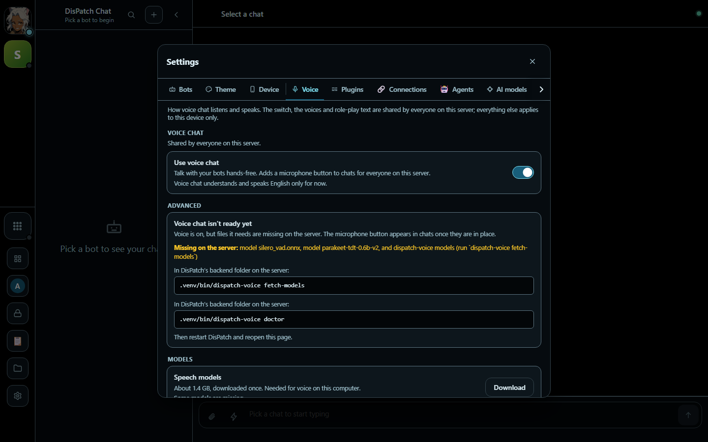
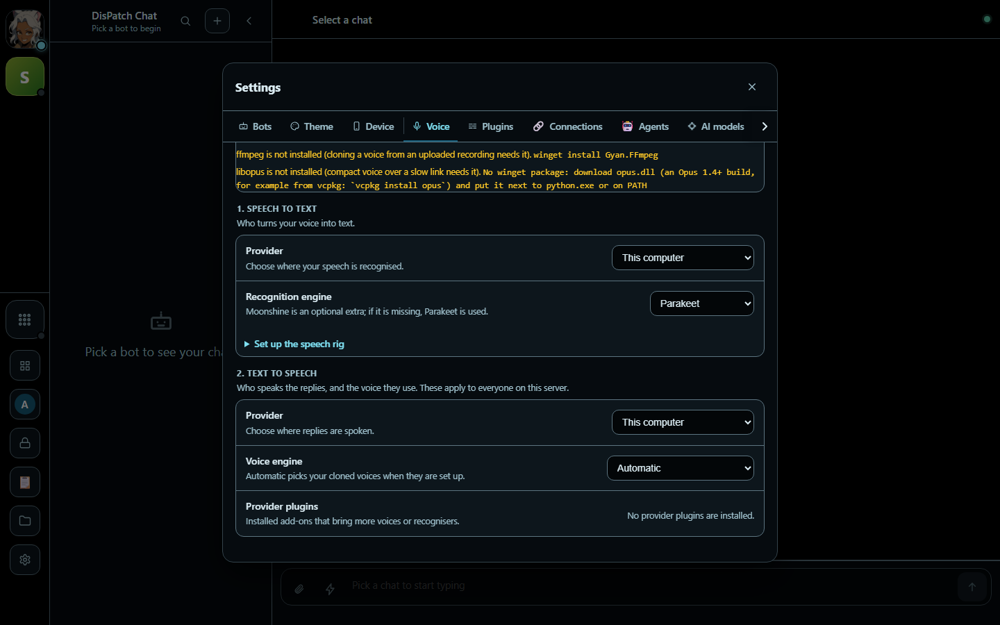

# dispatch-voice


<table>
  <tr>
    <td width="50%"><br><sub><b>Settings &rarr; Voice.</b> One switch to turn voice chat on, a plain list of what the server still needs, and a Download button for the speech models.</sub></td>
    <td width="50%"><br><sub><b>Providers.</b> Choose where speech is recognised and where replies are spoken: this computer, a GPU speech rig, or an OpenAI-compatible server.</sub></td>
  </tr>
</table>

<sub>Captured in DisPatch Chat 3.0 with the add-on installed and its speech models not yet downloaded.</sub>

**DisPatch Voice**: voice chat for [DisPatch Chat](https://github.com/LaserLloyd/DisPatch_Chat), as an add-on. You talk to a DisPatch bot hands-free; it listens, answers in its own voice and can be interrupted. Everything runs on the CPU of the machine DisPatch runs on; by default nothing is sent anywhere. What you switch on does send data: the **GPU rig** receives your microphone audio and the reply text, an **OpenAI-compatible server** (speech to text, or the HQ voice) receives the audio or the reply text, and the optional **MiniMax** engine receives the reply text. Each is off until you set it up, each address is checked against a network policy (below), and nothing else leaves the machine.

DisPatch runs fully without it. With the add-on installed, DisPatch gains a microphone button in each chat and a Settings → Voice page. The add-on is the whole feature: the speech pipeline (Silero VAD + Smart Turn v3.2 for turn taking, Parakeet TDT 0.6B for recognition), the voice session, the voices (cloned voices and a stock synthetic voice on Chatterbox-Turbo ONNX; optional built-in voices through a plugin), the settings routes and its own frontend assets. DisPatch keeps only a small, stable extension host and the page that explains how to install this when it is absent.

On the call screen there are three round buttons: **Mute**, **Type** (type your turn instead of speaking it; the reply is still spoken) and **Hang up**, plus an **Output** button on desktop browsers that choose where replies play (phone browsers cannot, so it is not shown there).

Docs: [docs/voice-chat/](docs/voice-chat/index.md) (install and setup, the host side, turn taking, the protocol).

## Install

DisPatch Voice is an add-on, not an app, so "install" means adding it to a DisPatch install (2.2.0 or
later; 3.0 recommended). Pick your platform; methods are listed simplest first. Every method ends the
same way: restart DisPatch, open **Settings, Voice**, switch it on and press **Download** for the models
(about 1.4 GB, with progress and Cancel).

**Ports:** none of its own. The add-on rides on DisPatch's port, `8765` (`/api/voice/*`, `/ext/voice/*`,
`/ws/voice/{thread}`); the DisPatch image exposes it, on DisPatch's bind address (`BIND_ADDR` in DisPatch's
`docker-compose.yml`). The only listener this package can start is the standalone Voices page,
`dispatch-voice serve` on `127.0.0.1:8769`, which neither DisPatch nor its image starts. A GPU rig
(SpeechForge, `1236`) is an optional outbound connection from the add-on to `rig.url`.

**System programs** come from the operating system, not pip: `ffmpeg` (required to clone a voice) and
`libopus` (optional). Each block below installs them; the DisPatch container image already includes both.
`dispatch-voice doctor` checks them and prints the command for your system.

### Windows

#### 1. DisPatch container image with voice (simplest)

Choose this if you run DisPatch in Docker. The image is built with the add-on, `ffmpeg` and `libopus`; the
models are downloaded into the data volume from the Settings page, and survive image updates.

```powershell
winget install --id Git.Git -e
winget install --id Docker.DockerDesktop -e
```

Start Docker Desktop once, then open a new PowerShell window:

```powershell
git clone https://github.com/LaserLloyd/DisPatch_Chat.git
cd DisPatch_Chat
Add-Content .env "VOICE=1"
docker compose up -d --build
docker compose ps
docker compose exec app ffmpeg -version
docker compose logs app | Select-String "SETUP TOKEN"
```

Open <http://localhost:8765>, create the owner with that token, then Settings, Voice, which lists what is
missing (the models, until you press Download). `ffmpeg -version` proves the system program is in the image. The default `VOICE_REF` installs the add-on
from this repository's `main` branch; set `VOICE_REF=refs/tags/<tag>` in `.env` to pin a
release. `VOICE_REF` takes a full ref (`refs/heads/<branch>`, `refs/tags/<tag>`) or a bare tag name. With
`VOICE_SRC=local` and `--build-context voice-src=<dir>` the add-on is installed from a local directory
instead. The speech models are not baked into the image; download them from Settings, Voice. DisPatch Chat's
`docs/voice.md` and `docs/deploy-docker.md` have the rest.

| Pros | Cons |
| --- | --- |
| One flag; ffmpeg and libopus are included | Image grows by about 0.84 GB (ffmpeg's libraries) |
| Models and voices live on the data volume, not in the image | Rebuild the image to update the add-on |
| One touch point after the build: Settings, Voice | Needs DisPatch in Docker |

#### 2. Add it to a native DisPatch with uv

Choose this if DisPatch runs from a clone with `uv`. Windows native DisPatch is experimental; see its
README.

```powershell
winget install --id Git.Git -e
winget install --id astral-sh.uv -e
winget install --id Gyan.FFmpeg -e
```

Open a new PowerShell window so the programs are on `PATH`, then:

```powershell
git clone https://github.com/LaserLloyd/DisPatch_Chat.git
git clone https://github.com/LaserLloyd/DisPatch_Voice.git
cd DisPatch_Chat\backend
uv sync
uv pip install --python .venv\Scripts\python.exe ..\..\DisPatch_Voice
.venv\Scripts\dispatch-voice.exe doctor --backend .
uv run --no-sync uvicorn app.main:app --port 8765
```

For the optional Opus link, put `opus.dll` next to `python.exe` (the add-on works without it, on raw PCM).
A later `uv sync` removes a pip-installed add-on, so repeat the `uv pip install` line after one.

| Pros | Cons |
| --- | --- |
| No container; the add-on is editable from the clone | `uv sync` in DisPatch removes it again; repeat the install line |
| Updating is `git pull` plus the install line | You install ffmpeg yourself |

#### 3. Standalone Voices page (try voice cloning without DisPatch)

Choose this to clone and audition a voice without running DisPatch. It serves a page on loopback only,
with no login.

```powershell
winget install --id Git.Git -e
winget install --id astral-sh.uv -e
winget install --id Gyan.FFmpeg -e
git clone https://github.com/LaserLloyd/DisPatch_Voice.git
cd DisPatch_Voice
uv sync
uv run dispatch-voice fetch-models
uv run dispatch-voice serve --data .\voices-data --port 8769
```

Open <http://127.0.0.1:8769> (it redirects to `/voices/ui`). Open a new PowerShell window after the `winget`
lines if a command is not found. See [Standalone use](#standalone-use) for the CLI and the library.

| Pros | Cons |
| --- | --- |
| Smallest way to hear the engine | Not connected to any chat; the page has no login |
| Everything in one folder | Models are a 1.4 GB download first |

### Linux

On a bare Ubuntu or Debian image `git` and `curl` are missing, so the blocks install them first.

#### 1. DisPatch container image with voice (simplest)

```bash
sudo apt-get update && sudo apt-get install -y git curl ca-certificates
curl -fsSL https://get.docker.com | sh
git clone https://github.com/LaserLloyd/DisPatch_Chat.git
cd DisPatch_Chat
echo "VOICE=1" >> .env
sudo docker compose up -d --build
sudo docker compose exec app ffmpeg -version
sudo docker compose logs app | grep "SETUP TOKEN"
```

Open <http://localhost:8765>, create the owner with that token, then Settings, Voice. Skip the second line
if Docker is already installed. (`dispatch-voice doctor` inside the container may report the models missing
even after the download, because it looks in the home folder instead of `/data`; trust the Settings page.)

| Pros | Cons |
| --- | --- |
| One flag; ffmpeg and libopus are included | Image grows by about 0.84 GB |
| Models and voices live on the data volume | Rebuild the image to update the add-on |

#### 2. Add it to a native DisPatch with uv

Choose this if DisPatch runs from a clone, by hand or as a systemd service.

```bash
sudo apt-get update && sudo apt-get install -y git curl ca-certificates ffmpeg libopus0
curl -LsSf https://astral.sh/uv/install.sh | sh
source "$HOME/.local/bin/env"
git clone https://github.com/LaserLloyd/DisPatch_Chat.git
git clone https://github.com/LaserLloyd/DisPatch_Voice.git
cd DisPatch_Chat/backend
uv sync
uv pip install --python .venv/bin/python ../../DisPatch_Voice
.venv/bin/dispatch-voice doctor --backend .
.venv/bin/uvicorn app.main:app --port 8765
```

`doctor --backend .` prints the handshake, the missing models and the system programs (run from `backend/`, `--backend .` points it at DisPatch's own environment). If DisPatch runs as a systemd
service, restart it instead of starting it by hand (`systemctl --user restart dispatch`). A later `uv sync`
removes a pip-installed add-on, so repeat the `uv pip install` line after one. To follow releases instead of a
checkout, install `"dispatch-voice @ https://github.com/LaserLloyd/DisPatch_Voice/archive/refs/tags/v1.6.0.tar.gz"` once that tag
is published (the `v1` tag still names 1.5.0).

| Pros | Cons |
| --- | --- |
| No container; works with the systemd unit DisPatch ships | `uv sync` in DisPatch removes it again |
| Editable from the clone for development | You install ffmpeg and libopus (the line above does) |

#### 3. Overlay with a release checkout (a server you keep running)

Choose this for an always-on DisPatch. Point an editable overlay at a release checkout nobody develops in,
and start DisPatch through its launcher, which falls back to DisPatch without voice (instead of a restart
loop) when the overlay cannot be resolved or crashes on import.

```bash
git clone https://github.com/LaserLloyd/DisPatch_Voice.git ~/DisPatch_Voice
git -C ~/DisPatch_Voice worktree add --detach ~/DisPatch_Voice-release origin/main
cd ~/DisPatch_Chat/backend
uv run --with-editable ~/DisPatch_Voice-release python -c "import dispatch_voice"
~/DisPatch_Chat/scripts/local-chat-launch --uv "$(command -v uv)" --with-editable ~/DisPatch_Voice-release \
    -- uvicorn app.main:app --host 0.0.0.0 --port 8765 --ws-ping-timeout 60 --ws-max-size 262144
```

Run the `import` line online after every release. `--offline` (added by the launcher), `--ws-max-size 262144`
and `--ws-ping-timeout 60` are load-bearing; [docs/voice-chat/host.md](docs/voice-chat/host.md#running-dispatch-with-the-add-on)
says why. Once a release tag such as `v1.6.0` is published, use it in place of `origin/main`; later releases:
`git -C ~/DisPatch_Voice-release checkout --detach <tag>`.

| Pros | Cons |
| --- | --- |
| Survives `uv sync`; what is in the folder is what goes live | Most steps; needs `--offline` care and a warm cache |
| Falls back to DisPatch without voice instead of crash-looping | You move the checkout to each release by hand |

#### 4. Standalone Voices page

```bash
sudo apt-get update && sudo apt-get install -y git curl ca-certificates ffmpeg
curl -LsSf https://astral.sh/uv/install.sh | sh
source "$HOME/.local/bin/env"
git clone https://github.com/LaserLloyd/DisPatch_Voice.git
cd DisPatch_Voice
uv sync
uv run dispatch-voice fetch-models
uv run dispatch-voice serve --data ./voices-data --port 8769
```

Open <http://127.0.0.1:8769> (it redirects to `/voices/ui`). Loopback only, no login; see [Standalone use](#standalone-use).

| Pros | Cons |
| --- | --- |
| Try the engine without a chat server | Not connected to any chat; 1.4 GB model download first |

### macOS

Expected to work but not tested (CI runs Linux and Windows). Use the Linux methods with
`brew install ffmpeg opus uv git` in place of the `apt-get` and `uv` install lines.

### Two packages in this repository

The host-independent engines (Silero VAD, Smart Turn, Parakeet and Moonshine recognition, Chatterbox-Turbo speech, the
OpenAI-compatible clients, the provider interfaces, the model downloads with progress and Cancel, the network address
policy and the optional GPU-rig client) are their own installable package, **`forge-voice-core`**, in
[`packages/forge-voice-core/`](packages/forge-voice-core/README.md). `dispatch-voice` is that package plus DisPatch's
integration (the FastAPI routes, the voice session, the browser client, the settings keys). `dispatch-voice` depends on
`forge-voice-core[speechforge]`, so installing the add-on installs both; nothing changes for a DisPatch user. Other
applications embed the core through [its host contract](packages/forge-voice-core/docs/HOST_API.md). The old import paths
(`dispatch_voice.host.tts`, `dispatch_voice.rt.*`, `dispatch_voice.engine`, ...) are kept as thin aliases of the moved
modules, marked deprecated.

How the two get installed (every route installs both; no step to remember):

* **A plain `pip install` or `uv pip install`** of the git URL, an archive, an sdist or a wheel: `dispatch-voice` declares
  its engines as a direct reference (`forge-voice-core[speechforge] @ https://github.com/LaserLloyd/DisPatch_Voice/archive/refs/heads/main.tar.gz#subdirectory=packages/forge-voice-core`),
  which pip and uv both resolve with no path dependency and no git on the machine. `scripts/check_installable.py` (CI job "Installable with plain
  pip") builds the wheel and the sdist, installs each into a clean venv with plain pip and imports both packages.
* **From a checkout** (every `uv pip install ../../DisPatch_Voice` line above, and `uv sync` here): the
  `[tool.uv.sources]` table in `pyproject.toml` swaps that URL for `packages/forge-voice-core` in the same checkout
  (editable, so edits to the core show up at once). The table is for development: the install is linked to that
  checkout, so after moving or deleting it, reinstall (add `--no-sources` to get a copy instead of a link).
* **A pinned release**: between releases the direct reference above follows `main`; the commit that is tagged names its
  own tag instead. To build any other tag or branch against its own copy of the engines, override the one requirement
  (uv only; pip has no `--override`). uv's `--override` replaces it wherever it is declared. In PowerShell write the file
  with `Set-Content -Encoding utf8` (PowerShell 5.1 `>` writes UTF-16, which uv cannot read):

  ```sh
  echo "forge-voice-core[speechforge] @ https://github.com/LaserLloyd/DisPatch_Voice/archive/refs/tags/v1.6.0.tar.gz#subdirectory=packages/forge-voice-core" > override.txt
  uv pip install --python .venv/bin/python --no-sources --override override.txt \
      "dispatch-voice @ https://github.com/LaserLloyd/DisPatch_Voice/archive/refs/tags/v1.6.0.tar.gz"
  ```

* **DisPatch's Dockerfile with `VOICE=1`** (stage "Optional: voice chat" in the DisPatch_Chat `Dockerfile`) does exactly
  that override from the same `VOICE_REF` (or, with `VOICE_SRC=local`, from `/voice-src/packages/forge-voice-core`), and
  fails the build unless `import dispatch_voice, forge_voice_core` works:

  ```sh
  # VOICE_SRC=local  (--build-context voice-src=<DisPatch_Voice checkout>)
  echo "forge-voice-core[speechforge] @ file:///voice-src/packages/forge-voice-core" > /tmp/voice-override.txt
  uv pip install --python /app/.venv/bin/python --no-sources --override /tmp/voice-override.txt /voice-src
  # VOICE_SRC=github (default; ${ref} is refs/heads/<branch> or refs/tags/<tag>)
  echo "forge-voice-core[speechforge] @ ${url}#subdirectory=packages/forge-voice-core" > /tmp/voice-override.txt
  uv pip install --python /app/.venv/bin/python --no-sources --override /tmp/voice-override.txt "dispatch-voice @ ${url}"
  ```

  `--no-sources` matters for `VOICE_SRC=local`: without it uv honours the editable path source and leaves a `.pth`
  pointing at `/voice-src`, a bind mount that does not exist in the finished image. Everything else in that stage (ffmpeg
  and libopus in the runtime image, models downloaded into the data volume, not baked in) stays as it is.

### Upgrade and uninstall

| Method | Upgrade | Uninstall (models and voices are kept) |
| --- | --- | --- |
| Container image | `git pull` in the DisPatch clone, then `docker compose up -d --build` | Remove `VOICE=1` from `.env` and rebuild. The data volume keeps `models/`, `voices/` and `voice.yaml` |
| Native, uv | `git pull` in the Voice clone, then the `uv pip install` line again; restart DisPatch | `uv pip uninstall --python .venv/bin/python dispatch-voice forge-voice-core`. Data stays in DisPatch's data folder |
| Overlay | `git -C <release-dir> checkout --detach <tag>`, run the warm-up `import` line online, restart | Drop `--with-editable` from the start line |

### Details

DisPatch 2.2.0 or later (newer DisPatch releases unlock more, see [Which DisPatch version](#which-dispatch-version)). Python 3.12 or later. Linux and Windows are tested in CI (the suite runs on both); macOS is expected to work but is not tested. Details in [docs/voice-chat/index.md](docs/voice-chat/index.md).

**System programs.** pip installs every Python dependency (including `websockets`, which the GPU-rig client needs), but two pieces come from the operating system:

| Program | For | Install |
|---|---|---|
| `ffmpeg` | decoding the clip you upload to clone a voice | `sudo apt install ffmpeg` / `sudo dnf install ffmpeg-free` / `brew install ffmpeg` / `winget install Gyan.FFmpeg` |
| `libopus` | the compact Opus wire on a slow link (optional; without it the link stays PCM16) | `sudo apt install libopus0` / `sudo dnf install opus` / `brew install opus` / Windows: put `opus.dll` next to `python.exe` |

`dispatch-voice doctor` checks both and prints the command for your system; `GET /api/voice/status` lists what is missing under `system` and `health`. They are declared in `pyproject.toml` (`[tool.dispatch-voice.system-requirements]`).

**Ports.** The add-on opens no port of its own. Everything it serves rides on DisPatch's port (8765 by default): `/api/voice/*`, the client files under `/ext/voice/*` and the voice socket `/ws/voice/{thread}`. The one listener this package can start is the standalone Voices page, `dispatch-voice serve` (`127.0.0.1:8769`, loopback only, never inside DisPatch). Outbound connections are only the ones you configure: the GPU rig at `rig.url` (SpeechForge listens on `:1236` by default), an OpenAI-compatible speech or transcription server, MiniMax, and the model downloads (GitHub, Hugging Face) when you press Download or run `fetch-models`.

**One page, no terminal.** With the add-on installed and DisPatch restarted once, everything else is Settings → Voice: switch it on, **Download** the models (about 1.4 GB, with progress and Cancel), pick the speech-to-text and text-to-speech providers, test the microphone. The commands above remain for servers configured as code.

`dispatch-voice doctor` prints the DisPatch handshake, which models are present, the engines and plugins, the switch, and whether the add-on the running server loaded is the one in this checkout (`--unit <name>` reads the voice settings and backend directory of a systemd `--user` unit; `--backend DIR` also checks DisPatch's venv and that the overlay resolves offline; `--check-update` compares with the latest release). `dispatch-voice fetch-models --verify` checks the speech models against their sha256 and that the Chatterbox files are present.

Optional: the Kokoro built-in voices are a separate, GPL-3.0-or-later plugin package, `dispatch-voice-kokoro`: install it and switch it on under Settings → Voice → *Provider plugins* (it registers through the `dispatch_voice.providers` entry-point group; the old `DISPATCH_VOICE_EXTENSIONS=dispatch_voice_kokoro:setup` still works and is deprecated). Optional: per-bot character in the acknowledgements and spoken status lines for your own tools in `<data>/voice-acks.yaml` ([docs/voice-chat/persona-acks-rp.md](docs/voice-chat/persona-acks-rp.md)).

The models live in ONE folder (DisPatch's `models_dir`) with a `speech/` and a `chatterbox/` subfolder. An install from before 1.6.0 keeps working where its files are; `dispatch-voice migrate-models` (dry run) and `--apply`, or the Move button, bring the old two folders into the new layout.

Voice chat understands and speaks English only for now. It works on an unlocked device and, with DisPatch 2.3.4 or later, on a locked (Safe Mode) one too, for the bots that device can chat with (the `safe` ones); every turn from a locked device, spoken or typed, runs with DisPatch's locked rules, and the voice settings stay unlocked-only. Since 1.3.4 a bot can use a different voice for locked devices: `bots.<id>.locked_voice` in `voice.yaml`, or the "Voice on locked devices" picker in the Bots-tab Voice popover. Empty (the default) means the bot's standard voice. The server picks it from the socket's locked flag, and a locked device cannot read the setting.

### Which DisPatch version

| Add-on feature | Add-on | DisPatch |
|---|---|---|
| Voice chat | 1.0 | 2.2.0 |
| GPU rig engine (SpeechForge) | 1.1.0 | 2.2.0 |
| Type button (`typed` frame), Output button | 1.2.0, 1.3.0 | 2.2.0 |
| Voice on a `safe` bot, for an unlocked device | 1.3.1 | 2.3.1 |
| Voice on locked devices | 1.3.3 | 2.3.4 |
| Per-bot `locked_voice` | 1.3.4 | 2.3.4 |
| Interrupt sensitivity | 1.5.0 | 2.2.0 |
| One Settings → Voice page (providers, model download, rig address and token), provider plugins | 1.6.0 | 2.2.0 |

On an older DisPatch the newer buttons are simply not available or the socket is refused, as the [changelog](CHANGELOG.md) notes per release.

## Engine

[Chatterbox-Turbo](https://huggingface.co/ResembleAI/chatterbox-turbo-ONNX) by Resemble AI, MIT licence, ungated, run through ONNX Runtime at q4 precision (~720 MB download). It was chosen on 2026-10-09 as the best MIT-licensed, ungated cloning model that runs on a CPU:

| Candidate | Licence | Result on the test machine (Ryzen AI 9 365, CPU) |
|---|---|---|
| **Chatterbox-Turbo ONNX q4** | MIT, ungated | profile build 0.7 s; RTF 0.7–0.9 on sentences; ~1.5–2 s to speak a short line; native `[laugh]`/`[chuckle]` tags; built-in Perth watermark |
| Chatterbox-Nano (PyTorch) | MIT, ungated | RTF 1.0–1.6, slower than real time |
| Chatterbox-Turbo (PyTorch) | MIT, ungated | RTF 2.2–3.1 |
| Chatterbox-Flash | MIT, ungated | needs CUDA (FlashInfer) |
| Kyutai Pocket TTS | code MIT, **cloning weights gated** | fastest (0.1 s first audio), but gated |
| NeuTTS Air | Apache-2.0 (not MIT) | not evaluated |

Quality check (2026-10-09): 20 renders across 10 lines, transcribed back with Parakeet. 19 were word-perfect. The miss was "Mm." rendered as "Mm-hmm", so the filler now *is* "Mm-hmm.". The speaker-match score separates voices clearly: clone vs reference 0.91, an unrelated male voice 0.54, a female voice 0.43.

**Sampling matters.** Resemble's ONNX example decodes greedily, and on a cloned voice that looped the reference clip's words for ten seconds. The engine samples the way Resemble's own PyTorch code does (temperature 0.8, top-p 0.95, top-k 1000, repetition penalty 1.2), and caps output length by word count. `packages/forge-voice-core/tests/test_models.py::test_no_runaway_or_reference_replay` guards this.

Models are pinned to a Hugging Face commit (`MODEL_REVISION` in `engine.py`) and to revisions with sha256 checksums for the speech models (`host/download.py`), so a re-download can't change what you tested. They live in plain directories, not the HF cache: onnxruntime refuses external-data files reached through the cache's symlinks.

## Optional: GPU rig

Since 1.1.0, a machine with an NVIDIA GPU running SpeechForge (a speech server speaking the `sf.1` protocol) can do the speech recognition, the end-of-turn score and the reply voice, so replies start sooner. It is off until you set it up:

```yaml
# <data>/voice.yaml
rig:
  enabled: true
  url: ws://<rig>:1236/v1/realtime
```

```sh
# the token, readable by you only (or SPEECHFORGE_TOKEN in DisPatch's environment). Settings -> Voice
# -> Rig token does the same, into DisPatch's credential store. <data> is DisPatch's data folder
# (/data in the container).
mkdir -p <data>/ext/voice && (umask 077 && printf 'SPEECHFORGE_TOKEN=%s\n' '<token>' > <data>/ext/voice/speechforge.env)
```

Then Settings → Voice → *Use the GPU rig when available*. This computer stays in charge of the conversation and takes over the speech work whenever the rig is slow, busy or away: a turn only starts on a rig that answered recently, a dead rig is noticed in under a second, and the words in flight replay into the local recogniser. Only voice conditionals go to the rig, never the reference clip. Details: [docs/voice-chat/rig.md](docs/voice-chat/rig.md).

## Settings and environment variables

Every setting has ONE definition ([`host/settings_schema.py`](src/dispatch_voice/host/settings_schema.py)): its type, default, range, whether it is a server, device or per-character setting, basic or advanced, secret or not, and its environment names. `GET /api/voice/settings/schema` serves the table; the Settings page, `PATCH /api/voice/settings` and `voice.yaml` are all generated from it.

**Order of precedence: the environment, then `voice.yaml`, then the default** (1.5.0 let `voice.yaml` beat every variable except `DISPATCH_VOICE`). `GET /api/voice/settings` reports `sources` (`env`, `file` or `default` for each key) and `env` (the variable that is winning); Settings → Voice shows "set by environment" next to such a setting and disables it. A value saved over a variable is kept in `voice.yaml` for when the variable goes (`overridden` in the PATCH answer says so). The environment is not range-limited (the app limits people, not the operator), except `DISPATCH_VOICE_MAX_SESSIONS`.

The owner PIN and owner login for the voice add-on are managed by the DisPatch host, not by this add-on: to list accounts run `python -m app users list`, and to reset the owner's password and PIN run `python -m app owner reset --yes` in DisPatch (see DisPatch_Chat's README).

The table below is generated from the schema (`python -m dispatch_voice.host.settings_schema --write-readme`); a test fails when it is stale.

<!-- env-table:start -->
| Environment variable | Setting | Default | Notes |
|---|---|---|---|
| `DISPATCH_VOICE` | `enabled` | False | Turns voice chat on. DISPATCH_VOICE=1/0 forces it (the switch is then locked). |
| `DISPATCH_VOICE_STT_PROVIDER` | `stt_provider` | cpu | cpu (this computer), openai (an OpenAI-compatible server), or a plugin's id. The GPU rig is switched with rig.enabled. |
| `DISPATCH_VOICE_STT_URL` | `stt_url` | - | A server with POST /v1/audio/transcriptions (whisper.cpp, faster-whisper-server, ...). |
| `DISPATCH_VOICE_STT_MODEL` | `stt_model` | - | Transcription model |
| `DISPATCH_VOICE_STT_TIMEOUT` | `stt_timeout_s` | 20.0 | Transcription timeout (s) |
| `DISPATCH_VOICE_STT_API_KEY` | `stt_api_key` | (unset) | Only ever read from the environment. |
| `DISPATCH_VOICE_STT` | `rt.stt_engine` | parakeet | Which recogniser hears you. Parakeet is the default; Moonshine is an optional extra (it falls back to Parakeet when missing). |
| `DISPATCH_VOICE_THREADS` | `threads` | 6 | onnxruntime intra-op threads. |
| `DISPATCH_VOICE_TTS_PROVIDER` | `tts_provider` | auto | auto (an OpenAI-compatible server when hq_url is set, else this computer), cpu (never the remote server), openai, or a plugin's id. The GPU rig is switched with rig.enabled. |
| `DISPATCH_VOICE_TTS` | `tts_engine` | auto | auto, chatterbox, minimax, or the name a plugin registered (kokoro). |
| `DISPATCH_VOICE_BUILTIN_VOICE` | `builtin_voice` | - | Changed with default_voice (it also accepts a cloned-voice profile). |
| `DISPATCH_VOICE_KOKORO_VOICE` | `builtin_voice` | - | older name of `DISPATCH_VOICE_BUILTIN_VOICE` |
| `DISPATCH_VOICE_SPEED` | `speed` | 1.05 | Engines that support a speed (a cloned voice keeps its own pace). |
| `DISPATCH_VOICE_KOKORO_SPEED` | `speed` | 1.05 | older name of `DISPATCH_VOICE_SPEED` |
| `DISPATCH_VOICE_TTS_THREADS` | `tts_threads` | 8 | ONNX threads (speech synthesis) |
| `DISPATCH_VOICE_HQ_URL` | `hq_url` | - | A server with POST /v1/audio/speech; the reply text is sent to it, and any failure falls back to this computer's voice. |
| `DISPATCH_VOICE_HQ_MODEL` | `hq_model` | - | Speech server model |
| `DISPATCH_VOICE_HQ_TIMEOUT` | `hq_timeout_s` | 4.0 | Speech server timeout (s) |
| `DISPATCH_VOICE_HQ_API_KEY` | `hq_api_key` | (unset) | Only ever read from the environment. |
| `DISPATCH_VOICE_MINIMAX_MODEL` | `minimax_model` | speech-2.8-turbo | MiniMax model |
| `DISPATCH_VOICE_MINIMAX_VOICE` | `minimax_voice` | Wise_Woman | MiniMax voice |
| `DISPATCH_VOICE_MINIMAX_BASE_URL` | `minimax_base_url` | https://api.minimax.io | MiniMax address |
| `MINIMAX_API_KEY` | `minimax_api_key` | (unset) | Only ever read from the environment. |
| `DISPATCH_VOICE_MERGE_WINDOW` | `merge_window_s` | 1.8 | Turn merge window (s) |
| `DISPATCH_VOICE_HARD_SILENCE` | `hard_silence_s` | 1.4 | Silence that ends a turn regardless of the turn-taking model. |
| `DISPATCH_VOICE_THINKING` | `voice_turn_thinking` | off | Thinking during voice turns |
| `DISPATCH_VOICE_SILENCE` | `no_smart_turn_silence_s` | 0.8 | End-of-turn silence without Smart Turn (s) |
| `DISPATCH_VOICE_PATIENCE` | `patience` | 1.0 | Server patience multiplier |
| `DISPATCH_VOICE_BARGE_ABORT` | `barge_abort_turn` | True | Barge-in also aborts the agent turn |
| `DISPATCH_VOICE_POWER_HOLD` | `rt.power_hold` | performance | Hold the performance power profile while a chat is open (Linux only). |
| `DISPATCH_VOICE_OPUS` | `opus` | auto | Opus codec |
| `DISPATCH_VOICE_MAX_SESSIONS` | `max_sessions` | 3 | Voice chats at once |
| `DISPATCH_VOICE_PREWARM` | `prewarm` | True | Load the models at start-up |
| `DISPATCH_VOICE_RIG_ENABLED` | `rig.enabled` | False | Use the GPU rig |
| `DISPATCH_VOICE_RIG_URL` | `rig.url` | - | ws:// or wss:// address of the speech server. Checked against a host allow-list. |
| `DISPATCH_VOICE_RIG_STT_FINAL_DEADLINE_MS` | `rig.stt_final_deadline_ms` | 350 | Rig: final-transcript deadline (ms) |
| `DISPATCH_VOICE_RIG_TTS_START_DEADLINE_MS` | `rig.tts_start_deadline_ms` | 800 | Rig: first-audio deadline (ms) |
| `DISPATCH_VOICE_RIG_AHEAD_MS` | `rig.ahead_ms` | 3000 | Rig: audio rendered ahead (ms) |
| `DISPATCH_VOICE_RIG_FIRST_CHUNK_TOKENS` | `rig.first_chunk_tokens` | 15 | Rig: first chunk (tokens) |
| `DISPATCH_VOICE_RIG_ALLOW` | `rig.allow` | - | Hosts, *.suffixes or CIDRs a PUBLIC rig address may be. Private, tailnet and loopback addresses need no entry; link-local and metadata addresses are never allowed. |
| `SPEECHFORGE_TOKEN` | `rig.token` | (unset) | Write-only: saved to a private file, never shown, never logged. |
| `DISPATCH_VOICE_EXTENSIONS` | `extensions` | - | Entry-point names from the dispatch_voice.providers group (or legacy module:setup targets). |
| `DISPATCH_SPEECH_MODELS` | `models_root` | - | Speech-model folder |
| `DISPATCH_VOICE_MODELS` | `chatterbox_models` | - | Chatterbox model folder |
| `DISPATCH_VOICE_MODEL_REVISION` | `model_revision` | - | Chatterbox model revision |
| `DISPATCH_DATA_DIR` | `data_dir` | - | Data folder |
| `XDG_DATA_HOME` | `data_dir` | - | Data folder |
| `DISPATCH_VOICE_ACK_RENDER` | `ack_render` | True | Pre-render acknowledgement lines |
<!-- env-table:end -->

## Standalone use

```sh
git clone https://github.com/LaserLloyd/DisPatch_Voice.git dispatch-voice && cd dispatch-voice
uv sync                                  # core: onnxruntime, no torch
uv sync --extra watermark                # + Perth watermark (CPU torch only, from the pytorch-cpu index)
uv run dispatch-voice fetch-models
uv run dispatch-voice serve --data /tmp/voices-test --port 8769      # the Voices panel: loopback only, no auth, its own folder
uv run dispatch-voice say <profile-id> "Okay, here's the thing [chuckle]." --data /tmp/voices-test -o line.wav
```

As a library, the pieces DisPatch uses are importable on their own:

```python
from dispatch_voice.engine import ChatterboxOnnx
from dispatch_voice.profiles import ProfileStore
from dispatch_voice import speak

store = ProfileStore(DATA_DIR / "voices", ChatterboxOnnx())       # load once (~3 s)
for frame in speak.speak(store, llm_token_stream, profile_id=None, stop=barge_in_event):
    ws.send_bytes(frame)            # 16-bit mono PCM, 24 kHz, 40 ms frames
ack = speak.filler(store)           # a pre-rendered "Mm-hmm." / "Right." in the same voice (standalone use)
```

`dispatch-voice serve` refuses to start without `--data` and refuses DisPatch's own voice store: the page has no login. It answers only a request whose `Host` is its own loopback address (a DNS-rebinding page gets 421).

`router.build_router` refuses to build without an auth dependency (`allow_open=True` only for tests, the standalone page and the DisPatch add-on, whose gate is DisPatch's). Write routes also refuse a browser `Origin` that doesn't match `Host`.

## Stock voice

Chatterbox has no built-in voice, so dispatch-voice ships one: `stock-host`, "Stock voice (synthetic)". It is built from `src/dispatch_voice/stock/synthetic-host.wav`, 12.6 s of fully synthetic speech (Kokoro-82M output, Apache-2.0 weights), so it is not a real person's voice. `fetch-models` builds its tensors once into `<models>/stock/stock-host.npz` (`--no-stock` skips this). `dispatch_voice.stock.ensure_stock(store)` then turns them into an ordinary profile; with `build=True` it builds the tensors itself when the cache is missing. `render_extras` adds the audition line and the fillers. DisPatch uses the stock profile when it has no other voice (inside DisPatch only its audition line is rendered: acknowledgements come from DisPatch's render queue, not the fillers). It never becomes the default on its own.

## Voice profiles

`<data>/voices/<id>/`, directory mode 0700:

| File | What |
|---|---|
| `original.<ext>` | the upload as received (so the profile can be rebuilt with a newer model) |
| `reference.wav` | trimmed, best 20 s window, loudness-normalised to −20 LUFS. This is what was cloned. |
| `voice.npz` | **the generation parameters**: the four speech-encoder tensors (`cond_emb`, `prompt_token`, `speaker_embeddings`, `speaker_features`). Loading takes milliseconds. |
| `profile.json` | name, quality report, match score, consent record, engine, timings |
| `audition.wav` | a fixed test line in the clone, worded unlike the recording script so a clone that parrots its reference is audible |
| `fillers/0-5.wav` | reaction sounds in the clone ("Mm-hmm.", "Right.", "Oh, nice."…), rendered in the background after a build on the standalone page, with fixed seeds (not inside DisPatch, whose voice chat renders its own acknowledgement lines) |

## Best practices built in

- **Clip guidance and checks.** Ask for 10–20 s of one person talking naturally, in a quiet room, with no music. Shorter than 5 s of speech is refused. Background noise, clipping and suspiciously flat dynamics (music, heavy compression) are flagged before anything is built. Long clips are cut to the 20 s window with the most speech.
- **Record mode** turns off the browser's echo cancellation, noise suppression and auto-gain: those artifacts would be cloned too. The on-screen script is conversational, with a question and an aside, because an expressive reference gives an expressive voice.
- **Consent is mandatory and recorded per profile:** "my own voice", "I have the speaker's explicit permission", or "synthetic / stock voice". A synthetic host voice is the recommended choice.
- **Watermarking.** With the `watermark` extra, every output carries Resemble's inaudible Perth watermark. Verified: detected as 1.0 in output, 0.0 in clean audio.
- **Private by construction.** Profiles stay on the box. `.gitignore` excludes `voices/`, `models/` and `*.npz`, and the profile store's file route serves only an allowlist of wavs (never `voice.npz`). IDs are validated against path traversal.
- **Upload hardening.** 20 MB cap, ffmpeg decoding with a fixed argv over pipes (no shell, no temp files), atomic profile writes (a failed build leaves nothing behind).

## Tests

```sh
uv run pytest -q                 # Python; model-backed tests skip when the models are absent
uv run pytest -q packages/forge-voice-core/tests   # the host-independent engines (also imports without dispatch_voice / fastapi)
npm install && npm test          # client modules (node --test; jsdom for the DOM suites)
python3 scripts/check-locales.py # locale bundles
```

`npm test` needs Node `^22.22.2 || ^24.15.0 || >=26`, the range jsdom 30 declares (`engines` in `package.json` says the same); on other versions `npm install` warns with EBADENGINE.

See [tests/README.md](tests/README.md) for the layout, the DisPatch stand-in (`tests/fakes.py`), the fixtures, and how to run the model-backed and browser harnesses on a shared machine. The cross-repo contract test (`tests/contract/`) runs against a DisPatch checkout (`DISPATCH_BACKEND`); `tests/e2e_voice_roundtrip.py` walks a whole voice chat on a scratch server, with or without DisPatch.

Before committing, install the privacy hooks once (`sh scripts/install-hooks.sh`). They run `scripts/scrub_check.py` on every commit, commit message and push; personal identifiers go in the git-ignored `scripts/scrub-rules.local.txt`.

Third-party licences: `THIRD_PARTY_NOTICES.md`.

## Limits

- First audio for a short line is ~1.5–2 s on this CPU, against ~0.1 s for Pocket TTS. Acknowledgements cover the gap in voice chat.
- English only (Turbo is English-only).
- One synthesis at a time per engine instance (CPU-bound).
- The `watermark` extra pulls CPU torch (~200 MB) plus librosa. Perth imports `pkg_resources`, hence `setuptools<81`.
